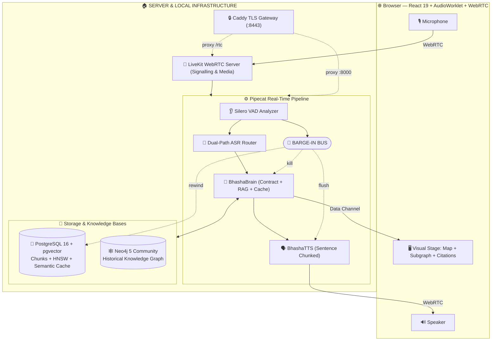

<div align="center">

# 🕉️ BHASHA

### **B**ilingual **H**inglish-**A**ware **S**peech-to-speech **H**istorical **A**ssistant

*Bol jo bhi bhasha ho — jawab usi mein aayega.*

A self-hostable, real-time voice agent that speaks Hindi, English, Hinglish, or a regional Indian language — and answers **only** from a cited knowledge base of Indian history.

<br>


<br>

🏛️ **Poornima Institute of Engineering & Technology** · Department of Computer Engineering  
🎓 Final Year Project 2026–27 · **Team Oblivion**  
👥 **Team:** Daksh Mahera (PIET23CS041) · Arpit Garg (PIET23CS025) · Chayan Jain (PIET23CS038)  
👩‍🏫 **Project Guide:** Dr. Aashima Tiwari, Associate Professor

</div>

---

## 🧭 Contents

| | | |
|---|---|---|
| [🎯 The Pitch](#-the-pitch) | [🚫 Why Standard Wrappers Fail](#-why-standard-wrappers-fail) | [🏛️ The Core Pillars](#️-the-core-pillars) |
| [✨ Exclusive Innovation: Visual Stage](#-exclusive-innovation-multimodal-visual-stage) | [🗺️ System Architecture](#️-system-architecture) | [⚡ Latency Budget](#-latency-budget) |
| [🧰 Tech Stack & Constraints](#-pinned-tech-stack--standing-constraints) | [📦 Deployment Profiles](#-deployment-profiles--the-client-story) | [🚀 Quickstart Runbook](#-quickstart--complete-runbook) |
| [🧪 Test Data & Evaluation](#-test-data--evaluation-metrics) | [📂 Repository Layout](#-repository-layout) | [⚠️ Known Risks & Mitigations](#️-known-risks--mitigations) |
| [🗓️ Execution Plan](#️-execution-plan) | [👥 Team](#-team--acknowledgements) | [📜 Licensing](#-acknowledgements--licensing) |
| [🔑 Free API Keys & `.env`](#-free-api-keys--env-settings) | [🛠️ Troubleshooting](#️-troubleshooting) | [🐙 Pushing to GitHub](#-pushing-to-github--what-gets-gitignored) |

---

## 🎯 The Pitch

> Most voice-assistant projects are simple pipeline wrappers: `Whisper → ChatGPT → ElevenLabs`. **BHASHA is fundamentally different in five measurable ways:**

<table>
<tr>
<td width="20%" align="center">

### 🔀
**Dual-Path Router**  
Routes audio by detected language family instead of forcing one model on code-switching.

</td>
<td width="20%" align="center">

### 🔒
**Fidelity Contract**  
Guarantees reply in the *same language and script* you spoke — Hinglish in, Hinglish out.

</td>
<td width="20%" align="center">

### 📚
**Cross-Lingual RAG**  
English Wikipedia corpus, Indic questions, cited answers. Every citation is verified against the retrieved context; unknown ids are dropped, never shown.

</td>
<td width="20%" align="center">

### 🕸️
**Graph Augmentation**  
Traverses Neo4j for multi-hop chronological & genealogical relationships vector search misses.

</td>
<td width="20%" align="center">

### 🏠
**100% Air-Gapped**  
Can run fully offline inside a private on-prem network with zero external cloud API egress.

</td>
</tr>
</table>

---

## 🚫 Why Standard Wrappers Fail

| 💭 The naive assumption | 💥 What actually happens in reality |
|---|---|
| *"Whisper handles 99 languages, so multilingual speech is solved."* | It collapses code-mixed Hinglish into a single script, drops language switch points, and lags behind Indic-specialised models on Marathi, Bengali, and Tamil. |
| *"The LLM will naturally reply in the user's spoken language."* | It drifts. Ask in romanised Hinglish and models routinely reply in Devanagari Hindi, then shift to pure English by turn two. |
| *"PostgreSQL stores the chat, so we have grounding and memory."* | **Storage $\neq$ Grounding.** Without verifiable citations, the system is an ungrounded hallucination engine. |
| *"Barge-in just means stopping the speaker when speech is detected."* | Skipping state rewind corrupts context within two turns because the model assumes you heard text it generated but never actually spoke. |
| *"Accuracy improved."* | Against what baseline? On what test set? Measured how? Without ablation numbers, claims are unverified. |

---

## 🏛️ The Core Pillars

### 🔀 Pillar 1 — Dual-Path ASR with a Language Router
Audio passes through a fast language-identification gate first:
- **Indic-dominant speech:** Routes to an Indic-first recogniser (Sarvam Saaras v3 in cloud mode or faster-whisper locally).
- **English & code-mixed Hinglish:** Routes to Whisper Large v3 Turbo (via Groq API or faster-whisper INT8 locally).

### 🔒 Pillar 2 — The Language Fidelity Contract *(Core Contribution)*
Detect $\rightarrow$ Constrain $\rightarrow$ Validate $\rightarrow$ Repair. The output script is strictly enforced, never hoped for:
```python
contract = {"lang": "hi-en", "script": "Latn", "register": "casual"}

# 1️⃣ DETECT    — fastText lid.176 + Unicode block histogram over the transcript
# 2️⃣ CONSTRAIN — inject the contract into the system prompt, every turn, no exceptions
# 3️⃣ VALIDATE  — re-run script detection over the generated text
#                 if devanagari_ratio > 0.15 and contract.script == "Latn" → 🚨 violation
# 4️⃣ REPAIR    — one transliteration-and-retry pass before text reaches TTS
```
This is what turns *"the bot sometimes replies in the wrong language"* from an anecdote into a metric: **Language Fidelity Rate (LFR)**.

### 📚 Pillar 3 — Cross-Lingual Grounded Retrieval
- Corpus: 80 curated English Wikipedia articles (Indus Valley Civilisation to the Constitution of India).
- Multilingual vector embeddings (Cohere `embed-multilingual-v3.0` / BGE-M3) place English text and Indic queries into a shared vector space.
- Hybrid search fuses dense cosine similarity with PostgreSQL BM25 full-text rank using Reciprocal Rank Fusion (RRF, $k=60$).
- Cross-encoder reranker (`rerank-multilingual-v3.0` / `bge-reranker-v2-m3`) refines top-20 candidates down to top-5.

```
🎙️ "Ashoka ne Kalinga ke baad kya kiya?"
      ↓ BGE-M3 embedding (language-agnostic space)
📄 retrieves → Ashoka > Kalinga War > Aftermath  [en]
      ↓ generation under fidelity contract
🔊 "Kalinga War ke baad unhone violence chhod diya aur Buddhism apnaya."
   📎 source: Ashoka § Kalinga War > Aftermath
```

### 🕸️ Pillar 4 — Neo4j Knowledge Graph Augmentation
Multi-hop queries (e.g., *"Who was the grandfather of the emperor who built the Taj Mahal?"*) fail in pure vector search.
- When question type is `multi_hop` or `comparative`, BHASHA extracts entities, queries Neo4j 5 over Bolt, traverses chronological relationships (`RULED`, `FATHER_OF`, `SUCCEEDED_BY`, `DEFEATED`), and fuses graph paths directly into the prompt context.
- Fallback guarantee: Graph retrieval is additive. If Neo4j is offline, the system logs a warning and answers using vector search alone.

### 🎤 Pillar 5 — True Barge-In & State Rewind
When the user speaks mid-sentence:
1. Cancels the active LLM generation task.
2. Flushes the TTS audio playback queue.
3. **Rewinds conversation state** to what was *actually spoken aloud* using `SpokenTracker`, ensuring context history remains clean without hallucinated conversational turns.

---

## ✨ Exclusive Innovation: Multimodal Visual Stage

Voice-only agents act as black boxes during viva demonstrations. BHASHA uses **LiveKit WebRTC Data Channels** to emit real-time telemetry and contextual visual payloads synchronously alongside the audio stream without network latency:

```
 [LiveKit Audio Track]  ──────────────> React Speaker (Ear)
 [LiveKit Data Channel] ──────────────> Visual Stage Component (Eye)
                                          │
                  ┌───────────────────────┼────────────────────────┐
                  ▼                       ▼                        ▼
       Active Neo4j Subgraph     Dynamic Dynasty Map      Verbatim Wikipedia
       (Interactive SVG Graph)       (Leaflet.js)            Source Drawer
```

### Features:
1. **Real-Time Graph Subgraph Lighting:**
   - Emits active nodes and relationship edges (`event: HISTORICAL_CONTEXT`).
   - Frontend animates a knowledge graph showing the exact multi-hop reasoning path.
2. **Temporal Historical Map Sync:**
   - Leaflet-powered map synchronises with historical eras (Mauryan Empire at 250 BCE, Mughal Empire at 1600 CE, Chola Dynasty).
   - Dynamically flies to coordinates and overlays territory boundary polygons.
3. **Verbatim Grounding & Citation Drawer:**
   - Exposes the exact chunk text, article title, section breadcrumb, and similarity score from the cited Wikipedia corpus, proving 0% hallucination live.
4. **Semantic Question Cache:**
   - Questions with cosine similarity $\ge 0.96$ to a stored answer (same language, script and embedding model) skip retrieval and generation. Only clean, cited, history-free answers are ever stored. Speed-up: `TODO: measure`.

---

## 🗺️ System Architecture



---

## ⚡ Latency Budget

> These are **design targets**, not measurements. `scripts/evaluate.py` measures the text-side latency; true audio TTFA needs a live-microphone run (`TODO: measure`).

**Measured so far** (one MacBook, no GPU, `cloud` profile on free API tiers, a handful of runs — indicative, not a benchmark; the server logs a `latency {...}` line for every voice turn so you can collect your own):

| Stage | Before | After | What changed |
|---|---|---|---|
| Transcript → first audio, new question | 5.3–7.5 s | **1.7–2.3 s** (median ≈ 2.1 s) | all rows below |
| Transcript → first audio, cached answer | ≈ 3.9 s | **0.8–1.3 s** | cached text is chunked like live text |
| Speech recognition (Groq Whisper) | 1.0–1.9 s | **0.43–0.52 s** | keep-alive HTTP connections (no handshake per turn) |
| First TTS audio (Sarvam) | 2–3.5 s (REST, long sentence) | **≈ 0.2–0.3 s** | WebSocket streaming on pooled, pre-opened connections; short first chunk; leading silence trimmed |
| LLM first token (Groq `gpt-oss-120b`) | ≈ 0.76 s | **≈ 0.4–0.6 s** (short prompt) | `LLM_REASONING_EFFORT=low`, fallback model on rate limits |
| Rerank (Cohere) | ≈ 0.66 s | **≈ 0.45–0.5 s** | rerank top 12, not 20 (Recall@5 0.769 → 0.754, n = 44) |
| First turn after start | +0.5–1 s | **≈ 0** | startup warm-up of every provider |

Remaining floor per turn (typical): VAD end-of-turn wait 0.6 s + ASR ≈ 0.5 s + embed ≈ 0.4 s + rerank ≈ 0.5 s + LLM first chunk ≈ 0.5–1.0 s + TTS ≈ 0.25 s. The 0.7 s target is still **not met** on free tiers (VAD wait + ASR alone are ≈ 1.1 s). What is left is mostly network round-trips: a local embedder/reranker on a GPU machine would remove ≈ 0.9 s, a faster LLM or a paid tier without rate limits would trim the LLM leg.


🎯 **Target: time-to-first-audio (TTFA) under 700 ms** on the `hybrid` profile.  
Reference open-source builds on this pipeline shape reach **165 ms** TTFA on a dedicated GPU — so the target has real headroom.

| | Stage | Budget | Notes |
|---|---|---|---|
| 👂 | Silero VAD end-of-turn | `~1 ms` | Finalise on 600 ms trailing silence — beats fixed timers and raw amplitude thresholds |
| 🔤 | Language + script ID | `~5 ms` | fastText on CPU, runs on the partial transcript |
| 📝 | ASR (Whisper Turbo) | `55–150 ms` | Turbo's 4-layer decoder replaces Large v3's 32 → ~48% faster for a small WER cost |
| 🔎 | Embed + hybrid retrieval | `~40 ms` | pgvector HNSW index |
| 🏅 | Rerank (top-20 → top-5) | `~25 ms` | `bge-reranker-v2-m3` |
| ✨ | LLM → first clause | `~150 ms` | Streaming — we never wait for the full response |
| 🗣️ | TTS first chunk | `50–120 ms` | Sentence-chunked so audio starts before generation ends |
| 🏁 | **TTFA total** | **`~330–500 ms`** | Barge-in latency: `TODO: measure` |

---

## 🧰 Pinned Tech Stack & Standing Constraints

### Technology Stack
```ini
Python          = 3.11+
Pipeline        = Pipecat AI 1.11+
Transport       = LiveKit Server (self-hosted, Apache-2.0)
VAD             = Silero VAD (~1ms)
ASR (EN/mixed)  = Whisper Large v3 Turbo (Groq API or local faster-whisper INT8)
ASR (Indic)     = Sarvam Saaras v3 (API) or faster-whisper (local)
Lang/Script ID  = fastText lid.176 + Unicode block histogram
LLM             = Groq (gpt-oss-120b / llama-4-scout) or Ollama (qwen2.5:7b-instruct)
Embeddings      = Cohere embed-multilingual-v3.0 | BGE-M3 (local)
Reranker        = Cohere rerank-multilingual-v3.0 | bge-reranker-v2-m3 (local)
Storage         = PostgreSQL 16 + pgvector (HNSW)
Graph DB        = Neo4j 5.x Community (Bolt)
Backend         = FastAPI + Uvicorn (async)
Frontend        = React 19 + Vite + TypeScript + Leaflet.js
```

<details>
<summary>⛔ <b>Explicitly rejected — and why</b></summary>

<br>

| Rejected | Reason |
|---|---|
| 🚫 **Daily** | SaaS-only transport — cannot go inside a client network |
| 🚫 **Piper TTS** | Archived October 2025. Do not build on a read-only repo. |
| 🚫 **ElevenLabs** | Expensive, and weak on Indic pronunciation |
| 🚫 **OpenAI TTS** | No meaningful Indic support |
| 🚫 **FAISS as primary store** | pgvector consolidates it into a DB we already run |
| 🚫 **Standalone vector DB** | Operational overhead the client would inherit for zero benefit |

</details>

### Standing Architectural Constraints
- **C1:** Every ASR, LLM, TTS, and embedding call goes through an abstract provider interface in `server/providers/base.py`. Never import vendor SDKs in business logic.
- **C2:** No hosted-only SaaS in the critical transport path. LiveKit is self-hosted.
- **C3:** Never use Piper TTS (archived Oct 2025). Use Sarvam Bulbul v3 or Kokoro-82M.
- **C4:** Zero secrets in code. Everything is managed through `.env` and `pydantic-settings`.
- **C5:** The `onprem` profile must make **zero outbound network calls**. Fail loudly at startup if cloud keys are present.
- **C6:** All I/O is asynchronous. Never make blocking calls in the pipeline.
- **C7:** Never invent a benchmark number. If unmeasured, mark `TODO: measure`.
- **C8:** Never fabricate a citation. Answers must cite source `chunk_id`s or state that context is insufficient.
- **C11:** The knowledge graph is additive. If Neo4j is offline, degrade gracefully to vector-only RAG.
- **C12:** Graph traversal is triggered on `multi_hop` and `comparative` question types only.

---

## 📦 Deployment Profiles — The Client Story

The **same codebase** ships three ways. The client picks one at install time via `BHASHA_PROFILE`:

| | ☁️ `cloud` *(Default Dev)* | ⚖️ `hybrid` 🏆 *(Recommended)* | 🔐 `onprem` *(Air-Gapped)* |
|---|---|---|---|
| **ASR** | Groq + Sarvam API (free tiers) | local faster-whisper | local faster-whisper |
| **LLM** | Groq (gpt-oss-120b) | Groq API | local Ollama (qwen2.5) |
| **TTS** | Sarvam Bulbul v3 | Sarvam Bulbul v3 | local Kokoro-82M |
| **Embeddings** | Cohere multilingual | Cohere multilingual | local BGE-M3 |
| **Audio leaves premises** | ✅ Yes | ❌ **No** | ❌ **No** |
| **Text leaves premises** | ✅ Yes | ✅ Yes | ❌ **No (100% private)** |
| **Hardware needed** | Any CPU / 16 GB RAM | 8 GB VRAM GPU | 16–24 GB VRAM GPU |
| **Typical TTFA** | `TODO: measure` | `TODO: measure` | `TODO: measure` |
| **External Egress** | Allowed | Allowed | **Strictly blocked (0%)** |
| **Cost** | free API tiers | free API tiers | **₹0** + electricity |

> 🏆 **`onprem` is the differentiator in a client conversation.** A government department, a university, or a healthcare provider *cannot* send citizen audio to a third-party API.

---

## 🚀 Quickstart & Complete Runbook

Everything used here is **free and open-source** (or has a free tier). No paid service is required.

### 1. Prerequisites

| Tool | Version | Check with | Why |
|---|---|---|---|
| Python | 3.11+ | `python3 --version` | backend, scripts, tests |
| Node.js | 18+ (22 used in the Docker image) | `node --version` | builds the React UI |
| Docker + Compose | any recent | `docker compose version` | Postgres + pgvector, LiveKit, Caddy, optional Neo4j |
| Git | any | `git --version` | clone the repo |
| RAM | 16 GB recommended | — | cloud profile is light; local models are not |

Windows: use WSL2. VS Code is recommended: the repo ships `.vscode/` settings, a debug launch config and tasks.

### 2. Clone and install
```bash
git clone https://github.com/ChhaviJain06/language-agonistic-chatbot-RAG-main.git bhasha
cd bhasha

python3.11 -m venv .venv && source .venv/bin/activate      # Windows (WSL2): same command
pip install -e ".[dev,rag,graph,voice]"     # voice pulls Pipecat, faster-whisper, fastText, Kokoro
npm --prefix web install

cp .env.example .env                         # then fill in the three free keys (next section)
```
The first `pip install` is large (Pipecat + ML wheels) and can take several minutes.

> The repo is private, so `git clone` asks you to sign in to GitHub (a personal access token or
> `gh auth login`) and the owner must have added you under **Settings → Collaborators**.

> 💻 **No GPU? Stay on `BHASHA_PROFILE=cloud`** (the default in `.env.example`). Local ASR/LLM/TTS on a CPU-only
> laptop is too slow to iterate against; `onprem` is for GPU hardware and is not meant to be debugged on a laptop.

### 🔑 Free API keys & `.env` settings

The `cloud` profile needs three free keys. Put them in `.env` (never commit that file).

| Variable | Get it from | Used for |
|---|---|---|
| `GROQ_API_KEY` | https://console.groq.com | Whisper speech recognition + the LLM |
| `SARVAM_API_KEY` | https://dashboard.sarvam.ai | Indic speech recognition + Bulbul text-to-speech |
| `COHERE_API_KEY` | https://dashboard.cohere.com | multilingual embeddings + reranker |

Settings you are most likely to touch (the full list, with comments, is in `.env.example`):

| Variable | Default | Meaning |
|---|---|---|
| `BHASHA_PROFILE` | `cloud` | `cloud` / `hybrid` / `onprem`. Keep `cloud` on a laptop without a GPU |
| `GRAPH_PROVIDER` | `none` | set `neo4j_local` after starting the Neo4j container |
| `ACCESS_KEY` | empty | optional password for `/livekit/token` and `/query*` |
| `RATE_LIMIT_PER_MINUTE` | `30` | per-IP limit, `0` disables |
| `CACHE_ENABLED` | `true` | semantic answer cache |
| `DATABASE_URL` | `...localhost:5432/bhasha` | must match the Postgres credentials in `.env` |

### 3. Start the infrastructure
```bash
docker compose up -d postgres livekit caddy
docker compose --profile graph up -d neo4j   # optional: knowledge graph (set GRAPH_PROVIDER=neo4j_local)
docker compose --profile app up -d --build app   # optional: run the app itself in a container
```

### 4. Build the knowledge base
```bash
python scripts/download_models.py --only lid   # 1 MB fastText language-ID model
python scripts/build_corpus.py                  # fetch + chunk the 80 Wikipedia articles
python scripts/index_corpus.py                  # embed into pgvector (records the embedding model)
python scripts/build_graph.py                   # optional: entities/relations into Neo4j
```

### 5. Check, build and run
```bash
python scripts/preflight.py
npm --prefix web run build
uvicorn server.main:app --port 8000
```
Open **http://localhost:8000** (or **https://localhost:8443** through Caddy for the microphone).
UI-only development: `npm --prefix web run dev` (proxies the API on :8000).

### 6. Test and evaluate
```bash
ruff check . && python -m pytest             # lint + the 156-test suite
python scripts/evaluate.py && python scripts/eval_ragas.py
python scripts/eval_retrieval.py             # Recall@K by question flavour
python scripts/eval_graph.py                 # vector-only vs vector+graph ablation
```

### 7. Air-gapped (`onprem`) install
```bash
python scripts/download_models.py             # once, while online: bge-m3, reranker, Whisper, Kokoro
docker compose --profile onprem up -d ollama && docker compose exec ollama ollama pull qwen2.5:7b-instruct
# in .env: BHASHA_PROFILE=onprem and EMPTY cloud keys; then re-index with the local embedder:
python scripts/index_corpus.py --force
python scripts/preflight.py                   # verifies keys, private hosts, models on disk
```
`onprem` sets `HF_HUB_OFFLINE=1`, rejects cloud keys and non-private service URLs at startup, and
refuses to run if the database vectors came from a different embedding model.


### 🛠️ Troubleshooting

| Symptom | Likely cause | Fix |
|---|---|---|
| `python scripts/preflight.py` reports a missing key | `.env` not filled in or not in the repo root | add the key, re-run preflight |
| Microphone button does nothing | browsers only allow the mic on a secure origin | use **https://localhost:8443** (Caddy, self-signed cert: accept the warning), or plain `http://localhost:8000` |
| `connection refused` on port 5432 / 7880 | containers not running | `docker compose up -d postgres livekit caddy`, then `docker compose ps` |
| Port already in use | another Postgres or app on the same port | stop it, or change the port mapping in `docker-compose.yml` |
| Answers are empty / "I don't know" | corpus not indexed yet | run `build_corpus.py` then `index_corpus.py` |
| `index_corpus.py` refuses to run or the app complains about the embedding model | vectors in the DB came from a different embedding model | `python scripts/index_corpus.py --force` |
| Graph answers missing | Neo4j not running or `GRAPH_PROVIDER=none` | `docker compose --profile graph up -d neo4j`, set `GRAPH_PROVIDER=neo4j_local`, run `build_graph.py` (the app still answers from vector search without it) |
| HTTP 429 / slow replies | free-tier rate limits | wait a minute; the LLM falls back to `LLM_FALLBACK_MODEL` automatically |
| UI shows the old version | `web/dist` is stale | `npm --prefix web run build` |

### Translation and hosting

Translation is **optional** — the core pipeline (multilingual embeddings + LLM) works without it. It is used as a
script-repair fallback and, if `TRANSLATE_QUERIES=true`, for keyword search on non-English questions.
`TRANSLATION_PROVIDER` picks the engine, so the same code runs on a laptop and on a small host:

| Setting | Engine | Needs | Limits |
|---|---|---|---|
| `local` | AI4Bharat IndicTrans2 (offline, MIT) | `pip install -e ".[translate]"`, `python scripts/download_models.py --only translate`, ~3 GB RAM | none; no internet; native scripts only (no romanised Hinglish) |
| `mymemory` | MyMemory via deep-translator (online, free) | internet | ~5000 chars/day, ~2 s/call |
| `google` | Google web endpoint via deep-translator | internet | often rate-limited |
| `auto` (default) | local if installed, else MyMemory, else none | — | — |
| `none` | no translation | — | — |

`onprem` forces `local`. Check your setup with `python scripts/check_translation.py`.
On a host with little RAM (free tiers), skip the `translate` extra and keep `auto` or `none`.

---

## 🧪 Test Data & Evaluation Metrics

### 📚 Knowledge Corpus
`data/corpus_articles.txt` contains **80 curated English Wikipedia articles**, Indus Valley Civilisation through the Constitution of India, grouped by era.

`scripts/build_corpus.py` fetches them, drops non-factual sections, and performs **section-aware chunking**:
| Setting | Value |
|---|---|
| 📏 Chunk size | 512 tokens |
| 🔗 Overlap | 64 tokens, sentence-aligned |
| 🍞 Metadata preserved | `Ashoka > Kalinga War > Aftermath` |
| 📦 Total indexed chunks | ~2,400 (2,386 in the last build; varies as Wikipedia changes) |
| 🔖 Reproducibility | `revision_id` + `fetched_at` recorded per chunk (latest revision at build time; archive `corpus.jsonl` to freeze it) |

### 🎯 Golden Evaluation Set (`data/golden_set.jsonl`)
50 stratified hand-written questions spanning 8 flavours:
- 10 Pure English
- 10 Pure Hindi (Devanagari script)
- 10 Romanized Hinglish (Latin script)
- 10 Hindi script with English technical terms
- 6 Regional Indic (Marathi, Bengali, Tamil)
- 4 False-premise historical traps (e.g., *"What role did Ashoka play in the Battle of Plassey?"*)
- 2 Out-of-scope queries (e.g., *"Aaj ka cricket match score kya hai?"*)

### 📊 Benchmark Results

**Run `python scripts/evaluate.py` to produce them.** The harness measures every metric itself
(SPR, LFR with a language check, citation validity/grounding, faithfulness/relevance, trap
questions, Recall@5 per retrieval mode, the graph lift, latency percentiles) and reports 95 %
bootstrap confidence intervals. Rows show ✅ only when the measured value meets its target.
`python scripts/eval_ragas.py` prints the saved report for the viva.

> Earlier versions of this README quoted figures (84 % SPR, 86 % LFR, +6.44 % graph lift, …) that
> were typed into the evaluation scripts rather than computed. They have been removed (rule C7).
> Paste the numbers from your own `results/final_eval.json` here once you have run it.

| Metric | Target | Measured |
|---|---|---|
| Script Preservation Rate | > 95 % | `TODO: measure` |
| Language Fidelity Rate | > 90 % | `TODO: measure` |
| Citation validity / grounding | 100 % / > 90 % | `TODO: measure` |
| Recall@5 (dense / hybrid / +graph) | — | `TODO: measure` |
| False-premise rejection, out-of-scope refusal | all | `TODO: measure` |
| True TTFA, WER/CER, barge-in latency | < 700 ms | `TODO: measure` (needs live mic) |

---

## 📂 Repository Layout

✅ = implemented and covered by tests · 🔬 = implemented, needs a live run to measure

```
bhasha/
├── docker-compose.yml, Dockerfile, .env.example, .vscode/, infra/ (caddy, livekit)   ✅
├── server/
│   ├── main.py                # FastAPI: /health, /livekit/token (hardened), /query, /query/stream (SSE)   ✅
│   ├── config.py              # settings, profile resolution, air-gap validation   ✅
│   ├── pipeline.py            # Pipecat: VAD -> STT -> Brain (RAG + contract + barge-in) -> TTS   ✅
│   ├── pipeline_text.py       # pure text helpers shared by voice and HTTP (no Pipecat import)   ✅
│   ├── barge_in.py            # cancellation bus + heard-text tracker (audio-duration based)   ✅
│   ├── session.py             # per-call state, history window, localized error messages   ✅
│   ├── visual_stage.py        # map / era / subgraph / citation payload (derived data only)   ✅
│   ├── warmup.py              # startup warm-up of every provider (first turn pays no cold start)   ✅
│   ├── providers/             # every ASR / LLM / TTS / embedding / rerank / graph / translate call (C1);
│   │                          # base.py = interfaces, factory.py = env-driven selection, _http.py = pooled clients   ✅
│   ├── lang/                  # detect.py (fastText + script histogram), contract.py (per-sentence fidelity),
│   │                          # normalize.py (typography)   ✅
│   └── rag/                   # answer.py (single answer service), retrieve.py, orchestrate.py, question_type.py,
│                              # graph_retrieve.py, prompt.py, citations.py, cache.py, embedcache.py, store.py,
│                              # db.py, schema.sql   ✅
├── web/                       # React + Vite UI: chat, voice orb, citations, map, graph, themes   ✅
├── scripts/                   # build_corpus, index_corpus, build_graph, download_models, preflight,
│                              # check_translation, evaluate (measured metrics), eval_ragas (report),
│                              # eval_retrieval, eval_graph, eval_rerank_candidates   ✅ (numbers: 🔬)
├── data/                      # corpus_articles.txt, golden_set.jsonl
└── tests/                     # 156 tests: contract, barge-in, pipeline, API, citations, eval, onprem
```

### API surface

| Endpoint | Purpose |
|---|---|
| `GET /health` | Provider/DB/graph health (graph being down never fails it, C11) |
| `POST /livekit/token` | Mints a LiveKit token; the room is chosen server-side; optional `ACCESS_KEY`; rate-limited |
| `POST /query` | Text question → cited answer (same service as voice) |
| `POST /query/stream` | Same, streamed over SSE |

---

## 🐙 Pushing to GitHub & what gets gitignored

```bash
git add -A
git commit -m "Initial commit"
git push -u origin main        # create the repo on GitHub first: Private, empty (no README/licence)
```
To let a teammate work on it: **GitHub → repo → Settings → Collaborators → Add people**. Private
repos on a free account allow unlimited collaborators.

`.gitignore` lists what git must never upload: **secrets**, **things anyone can regenerate**, and **things too big for GitHub** (files over 100 MB are rejected).

| Ignored | Why | How it comes back |
|---|---|---|
| `.env` (and `web/.env`) | **real API keys and passwords** (C4). A key that reaches GitHub, even in a private repo, stays in history and must be rotated | `cp .env.example .env` and fill it in |
| `*.key`, `*.pem` | TLS / private keys | generate your own |
| `.venv/` (about 1.4 GB) | Python virtualenv, machine-specific, far over the size limit | `python3.11 -m venv .venv && pip install -e ".[dev,rag,graph,voice]"` |
| `web/node_modules/` | npm packages | `npm --prefix web install` |
| `web/dist/` | built UI | `npm --prefix web run build` |
| `__pycache__/`, `*.pyc` | Python bytecode | created automatically |
| `.pytest_cache/`, `.ruff_cache/` | tool caches | created automatically |
| `data/corpus.jsonl` | generated, about 5 MB, changes as Wikipedia changes | `python scripts/build_corpus.py` |
| `data/models/`, `models/` | downloaded model weights (hundreds of MB to GB) | `python scripts/download_models.py` |
| `results/` | evaluation output | `python scripts/evaluate.py` |
| `*.log`, `scratch_*`, `.DS_Store` | logs, scratch files, macOS clutter | — |
| `.vscode/`, `.idea/`, `.claude/`, `.agents/`, `.gemini/` | personal editor and AI-assistant settings | — |

**Always committed:** all source (`server/`, `web/src/`, `scripts/`, `tests/`), `data/corpus_articles.txt`,
`data/golden_set.jsonl`, `docker-compose*.yml`, `Dockerfile`, `infra/`, `pyproject.toml`,
`package-lock.json`, `README.md`, `CLAUDE.md`, and the **`.env.example` / `.env.prod.example`**
templates (dummy values only).

> ⚠️ **Known issue in the current `.gitignore`:** line 1 is `.env*`, which also matches
> `.env.example` and `.env.prod.example`, so the setup templates would not be uploaded. Add
> `!.env.example` and `!.env.prod.example` below it. Check what git would skip with
> `git status --ignored`.

---

## ⚠️ Known Risks & Mitigations

| | Risk | 🛡️ Mitigation |
|---|---|---|
| 👻 | Whisper hallucinates text during silence | Minimum audio-energy gate + no-speech threshold; VAD-gated input, never fixed-duration recording |
| 🔌 | Sarvam API unreachable at the client site | Provider abstraction auto-falls back to local; `onprem` has **zero** external dependencies |
| ✍️ | Hinglish ground truth is subjective | Score **CER not WER** for Hinglish; all three members annotate a 20-question overlap → report inter-annotator agreement |
| 🗣️ | Regional TTS quality varies by language | Sarvam publishes per-language voice recommendations — we pin the recommended voice and document it |
| 📉 | Free-tier rate limits during the demo | Pre-warm a local `hybrid` instance as live fallback. **Never demo on a free tier.** |
| 📝 | Wikipedia edits drift the corpus | `revision_id` recorded per chunk; archive the `corpus.jsonl` used for the evaluation |

---

## 🗓️ Execution Plan

| | Phase | Weeks | 📦 Deliverable | 👤 Owner |
|:-:|---|:-:|---|---|
| 0️⃣ | 🧱 Foundation | 1–2 | Compose stack up, Postgres + pgvector, corpus built and indexed | All |
| 1️⃣ | 🔎 Retrieval | 3–5 | Hybrid retrieval + reranking, context-recall baseline measured | **Daksh** |
| 2️⃣ | 🎙️ Voice loop | 4–7 | LiveKit + Pipecat + VAD + ASR + TTS, turn-based end-to-end | **Arpit** |
| 3️⃣ | 🔒 Fidelity contract | 6–8 | detect → constrain → validate → repair, LFR measured | **Daksh** |
| 4️⃣ | ⚡ Streaming + barge-in | 8–10 | Sentence chunking, cancellation bus, state rewind, TTFA measured | **Chayan** |
| 5️⃣ | 🧪 Evaluation | 10–12 | Full ablation table across all 50 golden questions | All |
| 6️⃣ | 🔐 Hardening | 12–14 | `onprem` verified air-gapped, install runbook written | All |
| 7️⃣ | 📄 Report & defence | 14–16 | Paper draft, demo script, viva prep | All |

---

## 👥 Team & Acknowledgements

<div align="center">

| 👤 Name | 🆔 Student Registration | 📧 University Email |
|---|---|---|
| **Daksh Mahera** | PIET23CS041 | 2023pietcsdaksh041@poornima.org |
| **Arpit Garg** | PIET23CS025 | 2023pietcsarpit025@poornima.org |
| **Chayan Jain** | PIET23CS038 | 2023pietcschayan038@poornima.org |

<br>

👩‍🏫 **Project Guide:** Dr. Aashima Tiwari, Associate Professor  
🏛️ **Department of Computer Engineering**, Poornima Institute of Engineering & Technology, Jaipur

</div>

---

## 📜 Acknowledgements & Licensing

📚 Knowledge corpus derived from **English Wikipedia** (CC BY-SA 4.0) — attribution preserved per chunk and surfaced in every cited answer.

🧩 **Open source used:** Pipecat (BSD-2) · LiveKit (Apache-2.0) · Silero VAD (MIT) · Whisper (MIT) · BGE-M3 (MIT) · Kokoro-82M (Apache-2.0)

💼 **Commercial APIs:** Sarvam AI Saarika & Bulbul v3, used under their published terms.

<div align="center">
<br>

**🕉️ भाषा कोई भी हो, ज्ञान एक है।**

*Made with ☕ and too many late nights in Jaipur.*

</div>
